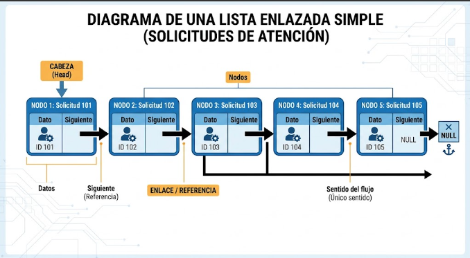
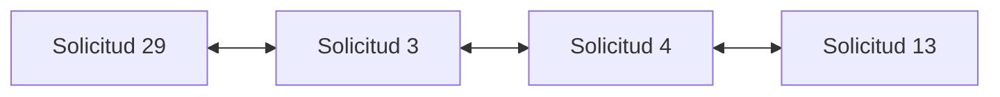
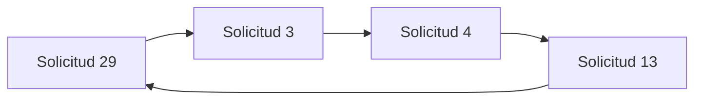

# README — Evaluación producto académico 2

> **Curso:** ALGORITMO Y ESTRUCTURA DE DATOS BASADOS EN INTELIGENCIA ARTIFICIAL  
> **Código:** 30690  
> **Evaluación:** PA2  
> **Equipo:** [Grupo Programadores]  

## 1. Integrantes

| N° | Integrante | Aporte principal |
|---|---|---|
| 1 | Wilmer Jamener Guevara Ramos | [Aporte / Rol] |
| 2 | Javier Alonso Gallegos Rodriguez | listas dobles y circulares, diagramas y justificación |
| 3 | Joseph Antonio Fong Millones | Redacción, diagramación y documentación de estructuras dinámicas |
| 4 | Marco Ychuta Saldivar | [Aporte / Rol] |
| 5 | Genesis Paloma Lucia Chuqui Allca | [Aporte / Rol] |

---

## 2. Descripción del caso de trabajo

**Caso de Estudio:**  
Una organización requiere gestionar una secuencia dinámica de solicitudes de atención. El registro cambia constantemente: ingresan nuevos casos, algunos se eliminan, otros deben reubicarse y en ciertos procesos se necesita navegar en ambos sentidos o mantener un ciclo continuo de revisión.

**Objetivo:**  
Diseñar y fundamentar el uso de listas enlazadas (simples, dobles y circulares) para estructurar el flujo de solicitudes de atención, optimizando la inserción, eliminación, reubicación y recorrido bidireccional o continuo de los datos.

---

## 3. Desarrollo de la Actividad 1: Fundamentos y Representación de Listas Enlazadas

### 3.1. ¿Qué es una lista enlazada?
Una lista enlazada es una estructura de datos dinámica compuesta por una serie de nodos. Cada nodo almacena un dato (información de la solicitud) y una o más referencias (punteros) hacia otros nodos. A diferencia de un arreglo convencional, no requiere memoria contigua ni un tamaño fijo predefinido, lo que facilita las operaciones de inserción y eliminación sin necesidad de desplazar elementos adyacentes.

**Relación con el caso planteado:**  
En el sistema de la organización, las solicitudes de atención ingresan, se atienden o se eliminan en tiempo real. La lista enlazada permite gestionar esta secuencia dinámica reordenando únicamente los punteros de los nodos sin necesidad de reestructurar todo el conjunto de datos.

### 3.2. Clasificación de listas enlazadas
* **Lista enlazada simple:** Cada nodo contiene un campo de datos y una referencia únicamente al siguiente nodo. Se recorre en un solo sentido desde la cabeza (`Head`) hasta encontrar un valor nulo (`NULL`).
* **Lista doblemente enlazada:** Cada nodo posee dos referencias: una al nodo siguiente y otra al nodo anterior. Permite la navegación bidireccional (avanzar y retroceder) a partir de cualquier nodo.
* **Lista circular:** El último nodo de la secuencia no apunta a `NULL`, sino que se conecta de regreso al primer nodo (cabeza). Permite ciclos continuos de revisión de elementos.

> **Estructura idónea para el caso:** Para cumplir con todos los requerimientos del caso de trabajo (navegación bidireccional y ciclo continuo de revisión), la estructura óptima a implementar es una **lista doblemente enlazada circular**.

---

### 3.3. Representaciones Gráficas de la Lista Enlazada (5 Nodos)

#### A. Representación Básica (Lista Enlazada Simple)
Ilustra la estructura unidireccional básica con 5 solicitudes de atención finalizando en `NULL`:

* **Descripción:** Comienza en la cabeza (`Head`), cada nodo almacena la solicitud (`ID 101` a `ID 105`) y el puntero al siguiente nodo. La lista finaliza con la referencia a `NULL`.

#### B. Representación Adaptada al Caso (Lista Doblemente Enlazada Circular)
Estructura adaptada para permitir la navegación en ambos sentidos y la revisión cíclica continua:

* **Descripción:** Cada nodo contiene punteros a `Anterior` y `Siguiente`. El enlace circular conecta el último nodo (`Solicitud 105`) con el primero (`Solicitud 101`) y viceversa, permitiendo recorridos bidireccionales continuos.

---
ssdsds
class Nodo {
    int dato;
    Nodo next;

    public Nodo(int dato) {
        this.dato = dato;
        this.next = null;
    }
}

public class Main {
    Nodo head;

    // PREGUNTA 1: Recorrido completo de la lista
    public void recorrer() {
        Nodo actual = head;

        while (actual != null) {
            System.out.print(actual.dato + " ");
            actual = actual.next;
        }

        System.out.println();
    }

    // PREGUNTA 2: Insercion al inicio
    public void insertarInicio(int dato) {
        Nodo nuevo = new Nodo(dato);
        nuevo.next = head;
        head = nuevo;
    }

    // PREGUNTA 3: Insercion al final
    public void insertarFinal(int dato) {
        Nodo nuevo = new Nodo(dato);

        if (head == null) {
            head = nuevo;
            return;
        }

        Nodo actual = head;

        while (actual.next != null) {
            actual = actual.next;
        }

        actual.next = nuevo;
    }

    // PREGUNTA 4: Insercion despues de un nodo dado
    public void insertarDespuesDe(int datoBuscado, int nuevoDato) {
        Nodo actual = head;

        while (actual != null && actual.dato != datoBuscado) {
            actual = actual.next;
        }

        if (actual == null) {
            System.out.println("No se encontro el nodo " + datoBuscado);
            return;
        }

        Nodo nuevo = new Nodo(nuevoDato);
        nuevo.next = actual.next;
        actual.next = nuevo;
    }

    public static void main(String[] args) {
        Main lista = new Main();

        // Crear lista original: 29 -> 3 -> 4 -> 13
        lista.head = new Nodo(29);
        lista.head.next = new Nodo(3);
        lista.head.next.next = new Nodo(4);
        lista.head.next.next.next = new Nodo(13);

        // PREGUNTA 1
        System.out.println("PREGUNTA 1: RECORRIDO COMPLETO");
        lista.recorrer();

        // PREGUNTA 2: Insertar 10 al inicio
        System.out.println("\nPREGUNTA 2: INSERCION AL INICIO");
        lista.insertarInicio(10);
        lista.recorrer();

        // PREGUNTA 3: Insertar 50 al final
        System.out.println("\nPREGUNTA 3: INSERCION AL FINAL");
        lista.insertarFinal(50);
        lista.recorrer();

        // PREGUNTA 4: Insertar 20 despues del nodo 3
        System.out.println("\nPREGUNTA 4: INSERCION DESPUES DEL NODO 3");
        lista.insertarDespuesDe(3, 20);
        lista.recorrer();
    }
}

//ACTIVIDAD 2.1.  El algoritmo visita cada nodo desde head hasta llegar a null, mostrando 
// sus datos. La estructura de la lista no cambia, porque únicamente se recorren los nodos.

            // RECORRIDO COMPLETO
                        29 3 4 13 

//ACTIVIDAD 2.2. Se crea un nuevo nodo con el valor 10, se conecta con el 
// primer nodo existente y se actualiza head para que apunte al nuevo nodo.
            //INSERCION AL INICIO
                        10 29 3 4 13 

//ACTIVIDAD 2.3  Se recorre la lista hasta encontrar el último nodo, cuyo enlace apunta
//  a null. Luego, se conecta ese nodo con el nuevo nodo que contiene 50.
//Antes: 10 → 29 → 3 → 4 → 13
//Después: 10 → 29 → 3 → 4 → 13 → 50 → null

//ACTIVIDAD 2.4  Se busca el nodo que contiene 3 y se inserta un nuevo nodo con el
//  valor 20 inmediatamente después de él. Se actualizan los enlaces para conservar 
// la conexión con los demás nodos.
//Antes: 10 → 29 → 3 → 4 → 13 → 50
//Después: 10 → 29 → 3 → 20 → 4 → 13 → 50 → null

## Actividad 4: Listas dobles y circulares

Los números 29, 3, 4 y 13 representan códigos de solicitudes de atención, siguiendo los ejemplos utilizados en las actividades 2 y 3.

### 4.1. Situación para utilizar una lista doble

El encargado necesita avanzar entre las solicitudes y regresar a una solicitud anterior para consultar sus datos. Para ello, cada nodo contiene el código de la solicitud y dos enlaces: `anterior` y `siguiente`.

**Representación gráfica:**

El enlace `anterior` de la solicitud 29 y el enlace `siguiente` de la solicitud 13 apuntan a `null`. Las flechas en ambos sentidos representan los enlaces entre nodos consecutivos.

**Justificación:**

La lista doble permite avanzar y retroceder directamente entre las solicitudes. Es más adecuada que una lista simple para este proceso porque permite consultar el nodo anterior sin recorrer nuevamente la lista desde el inicio.

### 4.2. Situación para utilizar una lista circular

El encargado necesita revisar periódicamente las solicitudes pendientes. Después de revisar la última solicitud, vuelve a la primera para comenzar una nueva ronda de seguimiento.

**Representación gráfica:**

Cada nodo tiene un enlace `siguiente`. El último nodo, correspondiente a la solicitud 13, apunta a la solicitud 29 en lugar de apuntar a `null`.

**Justificación:**

La lista circular permite continuar la revisión desde la última solicitud hasta la primera mediante el mismo enlace `siguiente`. Es más adecuada que una lista simple para representar un ciclo continuo, porque no es necesario reiniciar explícitamente el recorrido al llegar al final.

Para recorrer la lista una sola vez, se detiene el proceso cuando se regresa al nodo inicial. Si la lista está vacía, no se inicia el recorrido.

---

## 4. Evidencias

- Documento original de trabajo: `4134_Fong_Joseph_ListaEnlazada.docx`
- Diagrama 1: Lista enlazada simple de solicitudes (`lista_simple-10-13 185002.png`)
- Diagrama 2: Lista doblemente enlazada y circular (`Captura de pantalla...png`)

---

## 5. Matriz de participación

| Integrante | Desarrollo | Pruebas | Documentación | Exposición | Evidencia de participación |
|---|---|---|---|---|---|
| Wilmer Jamener Guevara Ramos | Alta | Alta | Media | Sí | Commits y avance de caso |
| Javier Alonso Gallegos Rodriguez | Alta | Media | Media | Sí | Commits y avance de caso |
| Joseph Antonio Fong Millones | Alta | Alta | Alta | Sí | Redacción de teoría y diagramas |
| Marco Ychuta Saldivar | Alta | Media | Media | Sí | Recoorido e insercion|
| Genesis Paloma Lucia Chuqui Allca | Alta | Media | Media | Sí | Commits y avance de caso |

---

## 6. Video de exposición

**Video público de YouTube:** [PEGAR AQUÍ EL ENLACE DEL VIDEO]

*Todos los integrantes participan con cámaras encendidas explicando la solución.*

---

## 7. Conclusiones

1. Las listas enlazadas proporcionan la flexibilidad requerida para un registro dinámico de solicitudes donde las inserciones y eliminaciones son frecuentes.
2. La implementación de punteros dobles (anterior y siguiente) resuelve la necesidad de navegación bidireccional en el flujo de revisión de la organización.
3. El enfoque circular elimina la presencia de límites (`NULL`) en los extremos, garantizando un ciclo continuo e ininterrumpido en la atención de casos.

---

**Última actualización:** 14/10/2026
